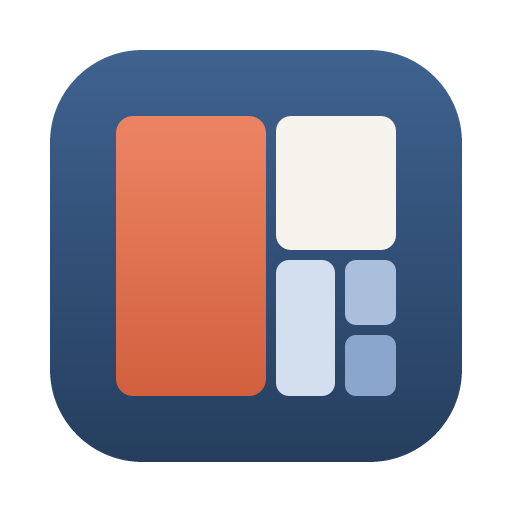

# diskmap



See what fills your disk. diskmap scans a folder in parallel and draws it as a nested,
squarified treemap: every rectangle is as big as the space it takes on disk, coloured by kind
(video, images, archives, code…). Walk into folders, find the biggest files, reveal them in the
file manager or move them to the Trash.

Native desktop app in Rust with [GPUI](https://www.gpui.rs/) and
[gpui-component](https://github.com/longbridge/gpui-component). macOS, Windows and Linux.
UI in Spanish, English, Portuguese and French.

## Features

- Parallel scan with live counters; cancel anytime.
- Real disk usage (allocated blocks), hard links counted once, symlinks never followed.
- macOS aware: skips firmlinked `/System/Volumes` (no double counting when scanning `/`),
  treats `.app`, `.photoslibrary` and other bundles as one item you can still open.
- Click to select, double-click / Enter to go in, Backspace to go up, breadcrumb to jump.
- Side panel: size, share of view and of the whole scan, contents, largest files, legend.
- Move to Trash (asks first, recoverable) and Reveal in Finder / Explorer.
- **Developer projects** (*Dev projects* in the top bar or on the start screen): finds the build
  folders under your home folder (or the folders you list) — `target/` of cargo / maven,
  `node_modules/`, `.next/`, Gradle's `.gradle/` and `build/`, Xcode's `DerivedData` — groups
  them by project (the git root above them) with size and when the project last changed, and
  lists a few exact caches (npm, pnpm, Gradle) and standalone cargo target folders such as
  `~/.cache/<app>-target`. Each row says what it is and what happens if it goes. **Nothing is
  pre-selected.** Never offered, by any rule: tool settings and installs (every hidden folder in
  your home — `~/.config`, `~/.local`, `~/.claude`, `~/.codex`, `~/.opencode`, `~/.vscode-server`,
  `~/.cargo`, `~/.nvm`, `~/.ssh`… — except those exact caches), `~/Library` (except Xcode's
  DerivedData and pnpm's store), cloud folders (iCloud Drive, OneDrive, Dropbox…), app bundles,
  system folders, whole user folders (Documents, Downloads…) and projects themselves — only build
  folders inside them, and `node_modules` only next to a `package.json`. Cleanup moves the
  folders to the Trash after listing every path and size and asking a second time; each folder
  is checked again right before (still that kind of build folder, not protected, not a link,
  and in a git repository ignored entirely by git). With [rama](https://github.com/otherwisetech/rama-rs)
  installed, git projects get *Open in rama* and the worktrees rama knows are marked.
- **Assistant** (⌘J): your own Claude Code, Codex, opencode or a local Ollama model, docked next
  to the map, reading what diskmap found (the biggest folders and files, space by type, developer
  projects with age and git state) through `diskmap mcp`. Try "What is filling up my disk?" or
  "What can I delete safely?". It can only propose moving regenerable build folders and caches to
  the Trash, as a card you accept; never settings, installs, cloud folders, personal files or
  projects, and nothing is pre-selected. Folder names and paths it reads go to the provider you
  chose.

## Download

Ready-made builds for macOS (Apple silicon and Intel), Linux and Windows are attached to each
[GitHub Release](https://github.com/otherwisetech/diskmap-rs/releases).

- **macOS:** unzip and drag `diskmap.app` to Applications. The app is not notarized yet, so the
  first time right-click it → *Open* (or run `xattr -dr com.apple.quarantine /Applications/diskmap.app`).
- **Linux:** extract the `.tar.gz` and run `./diskmap`; copy `diskmap.desktop` and the icon to
  `~/.local/share/applications` / `~/.local/share/icons` for a menu entry. Needs Vulkan.
- **Windows:** unzip and run `diskmap.exe` (SmartScreen may ask to confirm, since it is unsigned).

The downloads are built by GitHub Actions from the tagged source, but they are **not code-signed
or notarized** (that needs paid certificates), which is why macOS and Windows ask for confirmation
the first time. The only network request diskmap makes is reading the project's star count
(`api.github.com/repos/otherwisetech/diskmap-rs`, no login, nothing about you or your disk) at
most once a day, shown next to *Star on GitHub*; turn it off in the globe menu (*Show GitHub star
count*). Scans never leave your machine.

## Right-click a folder

- **macOS:** right-click a folder (or a disk) in Finder → **Analyze Space with diskmap**
  (*Analizar espacio con diskmap* in Spanish). It is a macOS Service, so it sits at the bottom of
  the menu, or under *Quick Actions* / *Services* when there are many. If it does not show up
  right after installing, open diskmap once or run `/System/Library/CoreServices/pbs -update`;
  it can be toggled in System Settings → Keyboard → Keyboard Shortcuts → Services → Files and
  Folders. diskmap is also listed under *Open With* for folders (Finder stays the default), and
  `open -a diskmap ~/Downloads` scans a folder from the terminal.
- **Linux:** `diskmap.desktop` declares `MimeType=inode/directory;`, so once it is in
  `~/.local/share/applications` file managers offer it for folders: Nautilus/Files → right-click
  → *Open With…* → diskmap; Dolphin → right-click → *Open With* → diskmap. Run
  `update-desktop-database ~/.local/share/applications` if it does not appear.
- **Windows:** on diskmap's start screen, click **Add “Analyze Space with diskmap” to Explorer**
  (the same button removes it). It writes only to your user's registry, no admin rights needed:

  ```reg
  Windows Registry Editor Version 5.00

  [HKEY_CURRENT_USER\Software\Classes\Directory\shell\diskmap]
  @="Analyze Space with diskmap"
  "Icon"="C:\\path\\to\\diskmap.exe"

  [HKEY_CURRENT_USER\Software\Classes\Directory\shell\diskmap\command]
  @="\"C:\\path\\to\\diskmap.exe\" \"%V\""
  ```

  plus the same under `Directory\Background\shell\diskmap` (right-click inside a folder) and
  `Drive\shell\diskmap`. Since the release is a plain zip, keep `diskmap.exe` where it is after
  adding the entry, or click the button again from its new place. On Windows 11 the entry is under
  *Show more options*.

## Works with other Otherwise apps

diskmap uses [otherwise-link](https://github.com/otherwisetech/otherwise-link), the small layer
Otherwise Technologies' apps share. Everything stays on your computer.

- **Links.** diskmap opens `otherwise-diskmap://` links (also `otherwise://diskmap/…` through
  [Otherwise Apps](https://github.com/otherwisetech/otherwise-apps)):

  | Link | Does |
  |------|------|
  | `otherwise://diskmap` | brings diskmap to the front |
  | `otherwise://diskmap/scan?path=/Volumes/Backup` | scans that folder or disk (absolute, percent-encoded path) |
  | `otherwise://diskmap/dev` | opens Developer projects |

  diskmap opens `otherwise://rama/repo?path=…` for *Open in rama*.

  macOS registers the scheme from the app's `Info.plist`; on Windows diskmap registers it for
  your user (`HKCU\Software\Classes\otherwise-diskmap`) every time it starts; on Linux
  `diskmap.desktop` declares `x-scheme-handler/otherwise-diskmap` and diskmap makes itself the
  handler when that file is in `~/.local/share/applications`.
- **Today.** While diskmap runs it checks your disks every 10 minutes and, when one has less than
  10 % free, puts an alert in Otherwise Apps' *Today* view that opens diskmap on that disk. The
  feed is `today/diskmap.json` in the shared Otherwise folder and expires a day after diskmap
  last ran. When the last Developer projects search found build folders and caches worth a tenth
  of that disk's used space, the alert says how much and opens Developer projects instead.
- **About** lists the other Otherwise apps installed on this computer; click one to open it.

## Where files live

diskmap keeps no documents: scans live in memory. Its settings, the small star-count cache, the
Developer projects folders (`dev-roots.txt`) and the last search's total (`dev-summary.json`, for
the Today alert) are in the Otherwise data folder, `~/.otherwise/diskmap/` (or wherever you moved the data root in
Otherwise Apps). Version 0.5 moves them there once from the old folder
(`~/Library/Application Support/diskmap`, `%APPDATA%\diskmap`, `~/.config/diskmap`), never
overwriting anything, and leaves a `.migrated-to-otherwise` note. *Show diskmap's settings folder*
is in the app menu and the globe menu; `OTHERWISE_DATA_DIR` points the data root elsewhere.

**Help → Crea tu tienda en Vcity** (also in About) is a short invitation to
[Vcity](https://vcity.io), online stores for businesses; the link only carries
`utm_source=diskmap`, nothing about you.

## Build and run

```sh
cargo run -p diskmap-app -- ~/Downloads     # or no argument for the start screen
script/bundle-macos.sh                       # macOS: target/release/diskmap.app (icon, Finder service)
cargo run --release -p diskmap-scan --example du -- ~   # scanner only, prints top entries
```

On macOS, grant **Full Disk Access** (System Settings → Privacy & Security) to see everything.

## Layout

```
crates/scan   diskmap-scan: parallel walker, Tree arena, squarified treemap layout, dev build
              folders (dev.rs) — no UI
crates/i18n   diskmap-i18n: embedded catalogs (es, en, pt, fr) and i18n guard tests
crates/app    `diskmap` desktop app
```

## License

MIT or Apache-2.0, at your option.

Developed by [Otherwise Technologies LLC](https://otherwisetech.com), Wyoming, USA.
